# Arc40 Trophy Case

A plain-language guide to trophies: how they work, what every rank means, the full list of all 179 trophies (Rounds 1 to
4), the activity log, The Arc, the unlock moment, sounds and the Dashboard shelf. **The Trophy Case is complete.** For how it is built, see the "Trophies" section of [CLAUDE.md](../CLAUDE.md).

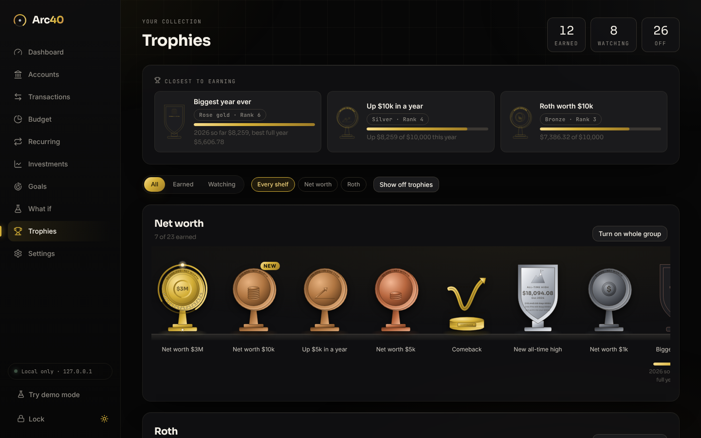

## How trophies work

Trophies are metal awards for real milestones in your money. You choose which ones matter to you; Arc40 does the
checking and awards them automatically.

### Off, On and Earned

Every trophy is in one of three states:

- **Off** (the start for every trophy): Arc40 is not watching it. It shows as a faint silhouette, and only when you
  click **Show off trophies**.
- **On** ("Watching"): Arc40 watches it and shows how close you are, for example "$43,100 of $50,000", "Held 12 of 30
  days" or "3 of 5 years maxed". It shows as an outline in its rank's color. A full progress bar always means earned.
  Some trophies judge a month or a year as a whole (Gear paid off 10x, Biggest year ever, Record ref month or year, Ref
  pay up, the yearly savings rate, New all-time high and a few more), so they can only be earned once that month or year
  has ended. When you are already ahead, the bar stops at 95% and the line says when it counts, for example "2026 so
  far: ref pay is 30x your ref costs. Counts on Dec 31 if it stays at 10x or more."
- **Earned**: awarded with a date, fully lit, with a soft light on the shelf under it. Earned trophies are permanent:
  if your numbers drop later, the trophy stays.

### Turning a trophy on

Click a trophy, then **Turn on**. Arc40 asks one question, with the suggested answer already picked:

- **Count my history**: look back through all your data. If you already qualified, the trophy is earned right away,
  dated the real day you first qualified.
- **Start from today**: only what happens from today on counts.

Balances, lifetime totals, counts and yearly trophies suggest **Count my history**. Trophies about spending suggest
**Start from today**: Growth beat a year of spending, Ref pay covered all spending, every Spending habits trophy, the
months covered, fully funded and refilled trophies on the Emergency fund and savings shelf, and Perfect months and Perfect
year on The long game shelf.

Every trophy starts Off on purpose: the owner chooses when a trophy should count, and "Start from today" lets it ignore
the past entirely.

**Turn on whole group** (on each shelf) turns on every Off trophy on that shelf, each with its own suggested answer,
after one confirm step that tells you how many it will turn on and how many count your history or start from today.
When most of them start from today, it says so in a plain sentence.

### Turning off and taking back

- **Turn off** stops watching an On trophy.
- **Take it back** on an earned trophy sends it back to **Off** (not On), so it is not awarded again on the next check.
  Nothing is deleted: Arc40 keeps a log of every award. Turning it on again later starts fresh with the answer you pick
  then.

### When Arc40 checks

Arc40 checks your On trophies when you open the Trophies page, each time you open the app, and a couple of seconds after
any change you make (an import, an edit, a balance, a setting). Just looking at a page never changes anything. A check
that runs late still gives the real date a trophy was earned.

### The unlock moment

When a trophy is earned, it gets its own full-screen moment, the same for every rank, in its own metal:

- The screen goes dark, slow rays turn behind the trophy in its metal (silver rays for Silver, emerald for Emerald, gold
  for Arc40) and a soft spotlight glows behind it.
- The trophy rises into the light, then a shine sweeps across it every few seconds.
- Underneath: "TROPHY EARNED", the trophy's name in its metal, its rank and shelf, and one line about what happened (the
  same line the close-up shows).
- **Next trophy (2 of 3)** or **Done**, and **See it in the case**, which opens the trophy's close-up on the Trophies page.
  With more than one waiting: "1 of 3", dots and a quieter **Skip the rest**.
- Esc, or a click anywhere except the trophy and the buttons, closes it. Closing in any way counts as seen for the whole
  queue. It works with the keyboard (Tab stays inside, Enter on the main button), and with the Mac's reduce motion
  setting it only fades.

**Each award is celebrated exactly once.** A reload, a second Arc40 tab or opening the app again never shows it twice. An
award that was never shown (for example the browser closed first) shows the next time Arc40 is open. When several
arrive at once, the smallest comes first and the biggest last, so the moment builds up; the same rank goes oldest first. Collector trophies come after
all the others, and The Arc is always the very last.
The moment waits while Arc40 Wrapped, the money flow full screen or any dialog is open. If turning a trophy on from its
close-up earns it right away, the close-up steps aside for it.

Trophies you had already earned before this update are counted as already celebrated, so nothing old replays.

### Trophy sounds

A short, soft chime plays as the trophy rises: richer for higher ranks (more notes and a longer shimmer), with its own
version for the Arc40 tier (a warm swell and a sparkle for each star). Each lasts about 1 to 2 seconds. The Arc gets the
grandest one: a longer, fuller Arc40 chime of about 3 seconds. It is made by
the browser itself: no sound files, nothing downloaded.

- **Settings > Trophy sounds** turns it on or off (on to start with) and has a **Hear it** button. It is separate from the
  Arc40 Wrapped sound.
- The speaker button in the corner of the moment turns the same setting off (and back on).
- Browsers only allow sound after you have clicked or pressed a key on the page. Before that, the moment shows silently.

### On the Dashboard

A Trophies card sits right under your net worth:

- Your 5 most recently awarded trophies on a small lit glass shelf (the newest first, with its NEW tag), each with its rank
  and earned date. Click one for its close-up. **Open the case** goes to the Trophies page.
- **Closest to earning:** the one watched trophy closest to being earned, with its progress ("Gold · $48,920 of $50,000").
- Nothing earned yet but some watched: only the closest one, with "Your first trophy is on its way."
- Everything Off: one small line, "Turn on trophies in the Trophy Case".

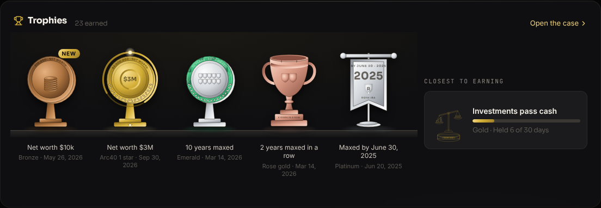

### The 30-day rule

Balance trophies (net worth, Roth worth, investments worth, growth, savings, months covered, and the "pass cash" and
"growth beats money put in" comparisons) are earned only after the value stays at or above the line for **30 days in
a row**. The earned date is the 30th day. One day below the line starts the count again. Days with no new data keep the
last balance, the same way the net worth chart works. Exactly at the line counts; one cent under does not.

### Yearly trophies

Some trophies come once per tax year ("Maxed the Roth 2026"). Each year is its own banner, from your first year with
Roth data through this year. When a new year starts, its banner starts On if last year's banner of the same kind was On
or Earned; otherwise it starts Off.

### The close-up

Click any trophy to see it large, with its rank and group, the date it was earned and how it was counted, one sentence
about what happened, a small "How you got there" chart, what is still needed (for On trophies) and the next rung of the
same ladder. Esc closes it.

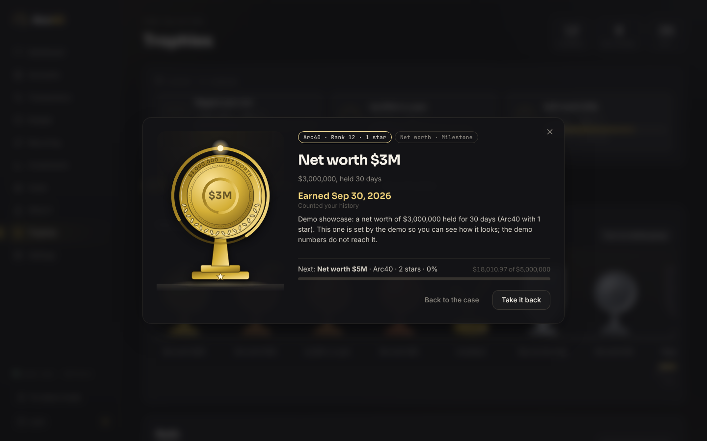

### The case

- At the top: how many trophies are **Earned**, **Watching** and **Off**, then **The Arc** in its own spot (see The Arc
  below), then the 3 you are **closest to earning**.
- Filters: **All / Earned / Watching**, one chip per shelf, and **Show off trophies**.
- One shelf per group, always in this order: Net worth, Investing, Roth, Emergency fund and savings, Refereeing,
  Spending habits, Keeping things tidy, The long game. The Arc is not on a shelf.
- On a shelf: earned trophies newest first, then On trophies by how close they are, then Off trophies (when shown). The
  newest earned trophy gets a gold **NEW** tag.
- Hover a trophy and it tilts toward the mouse, its shine follows the cursor and the shelf glows in its rank's color.
  With the Mac's reduce motion setting, there is no tilt or sweep. Every trophy also works with the keyboard (Tab, then
  Enter).

## Ranks

Rank is difficulty, with the same meaning everywhere. Ladders skip ranks they do not need.

| Rank | Name | Material |
|---|---|---|
| 1 | Iron | Dark brushed grey metal |
| 2 | Copper | Copper |
| 3 | Bronze | Bronze |
| 4 | Silver | Silver |
| 5 | Gold | Gold |
| 6 | Rose gold | Gold with a pink warmth |
| 7 | Platinum | Pale, cool platinum |
| 8 | Obsidian | Platinum with black glass and gold veins set into the face and trim |
| 9 | Emerald | Platinum with emerald set in |
| 10 | Ruby | Platinum with ruby set in |
| 11 | Diamond | Platinum with diamond (white, with small sparkles) set in |
| 12 | Arc40 | Gold inside the Arc40 ring, with a glowing core; above that, 1, 2 or 3 stars engraved below |

The metals keep their real colors in both the dark and the light theme; the case around them follows the theme.

## Shapes

| Shape | Used for |
|---|---|
| **Milestone coin** | Amount and count ladders. A thick coin on an angled stand, the amount engraved around the rim. Higher ranks get a fancier rim: plain, notched, a laurel border, then fine inner engraving. |
| **Streak cup** | Anything "in a row". A two-handled cup on a stepped base, one notch on the lip per unit of the streak, the length on a plate. |
| **Record plaque** | Bests that update. A shield with the current record and its date, older records struck through below. The only kind that changes after it is earned. |
| **Yearly banner** | One per year. Hangs from a crossbar with round end caps, the year large in the middle. |
| **Statuette** | One-offs. The design itself is a small sculpture on a round base with a nameplate. |
| **The Arc** | The Arc only (Round 4). A gold doorway with a glowing gem, on a stepped dark base with a gold plate. |

## The Round 1 trophies (43)

### Net worth (23)

Net worth is the same number the Dashboard shows, valued day by day (investments from fund prices).

**Net worth ladder** (coins, 30-day rule): the design grows from a single coin to stacks, a tower, coins in an arc, gold
bars, a pyramid of bars, a diamond-cut "1M" and finally the Arc40 ring around the amount.

| Trophy | Line | Rank |
|---|---|---|
| Net worth $1k | $1,000 | Iron |
| Net worth $5k | $5,000 | Copper |
| Net worth $10k | $10,000 | Bronze |
| Net worth $25k | $25,000 | Silver |
| Net worth $50k | $50,000 | Gold |
| Net worth $100k | $100,000 | Rose gold |
| Net worth $250k | $250,000 | Platinum |
| Net worth $500k | $500,000 | Obsidian |
| Net worth $750k | $750,000 | Emerald |
| Net worth $1M | $1,000,000 | Diamond |
| Net worth $2M | $2,000,000 | Arc40 |
| Net worth $3M | $3,000,000 | Arc40, 1 star |
| Net worth $5M | $5,000,000 | Arc40, 2 stars |
| Net worth $10M | $10,000,000 | Arc40, 3 stars |

**Up in one calendar year** (coins with rising arrows, 30-day rule): the gain is your net worth on the day minus your
net worth at the start of the year (the end of Dec 31 before it, the same start Arc40 Wrapped uses). The 30 days must all
be inside that year, and a year with no balance on the Dec 31 before it does not count.

| Trophy | Gain | Rank |
|---|---|---|
| Up $5k in a year | $5,000 | Bronze |
| Up $10k in a year | $10,000 | Silver |
| Up $25k in a year | $25,000 | Gold |
| Up $50k in a year | $50,000 | Platinum |
| Up $100k in a year | $100,000 | Emerald |
| Up $250k in a year | $250,000 | Diamond |

**One-of-a-kind:**

- **New all-time high** (Silver record plaque, a mountain peak with a flag): checked at each month end once the month
  is over. Earned on the first month end above every earlier one, after at least 3 earlier month ends. Every later
  record is added to the plaque.
- **Biggest year ever** (Rose gold record plaque, a calendar with a crown): growth over a full calendar year (Dec 31 vs
  the Dec 31 before). Earned on the first full year that beats every earlier full year; later records are added.
- **Comeback** (Gold statuette, a line that dips and climbs past its old high): net worth falls to 90% or less of its
  highest point, then stays above that old high for 30 days in a row.

### Roth (20)

Roth trophies use the same numbers as the Goals page: contributions counted by tax year in your Roth IRA accounts, with
their real sign (a reversal lowers the total), against the limit and deadline you saved for that year. A limit or
deadline is never guessed: without one, the trophy says "Enter the limit for 2027 first."

**Yearly banners** (one per tax year, a shield with "R"):

| Trophy | Rule | Rank |
|---|---|---|
| Maxed the Roth (year) | The year's contributions reach the limit by the deadline | Gold |
| On pace all year (year) | At every month end from Jan 31 to the last month end before the deadline, the Roth pace was on pace, ahead or maxed (never behind), and the year got maxed | Silver |
| Maxed by June 30 (year) | The year's contributions reach the limit by June 30 of that year (needs only the limit) | Platinum |

A yearly banner is earned on the day of the contribution that first brought the year to its limit.

**Years maxed** (shields lined up; counted from your data whatever the banners say):

| Trophy | Rule | Rank |
|---|---|---|
| 2 years maxed in a row | Two tax years in a row maxed (streak cup) | Rose gold |
| 5 years maxed | 5 tax years maxed (coin) | Obsidian |
| 10 years maxed | 10 (coin) | Emerald |
| 15 years maxed | 15 (coin) | Diamond |
| 20 years maxed | 20 (coin) | Arc40 |

**Total contributions** (coins, a vault door marked "R" that gets heavier; every Roth contribution of every tax year,
with its real sign):

| Trophy | Total | Rank |
|---|---|---|
| $10k put into the Roth | $10,000 | Silver |
| $25k put into the Roth | $25,000 | Gold |
| $50k put into the Roth | $50,000 | Platinum |
| $100k put into the Roth | $100,000 | Emerald |
| $150k put into the Roth | $150,000 | Diamond |

**Roth worth** (coins, the vault door opening wider with a glow inside; your Roth IRA balance, the same as the Accounts
page, 30-day rule):

| Trophy | Balance | Rank |
|---|---|---|
| Roth worth $10k | $10,000 | Bronze |
| Roth worth $50k | $50,000 | Gold |
| Roth worth $100k | $100,000 | Platinum |
| Roth worth $250k | $250,000 | Emerald |
| Roth worth $500k | $500,000 | Diamond |
| Roth worth $1M | $1,000,000 | Arc40 |

**First Roth contribution** (Bronze statuette, a shield with a seedling): your first Roth contribution above $0.

## The Round 2 trophies (45)

### Investing (28): trees and growth

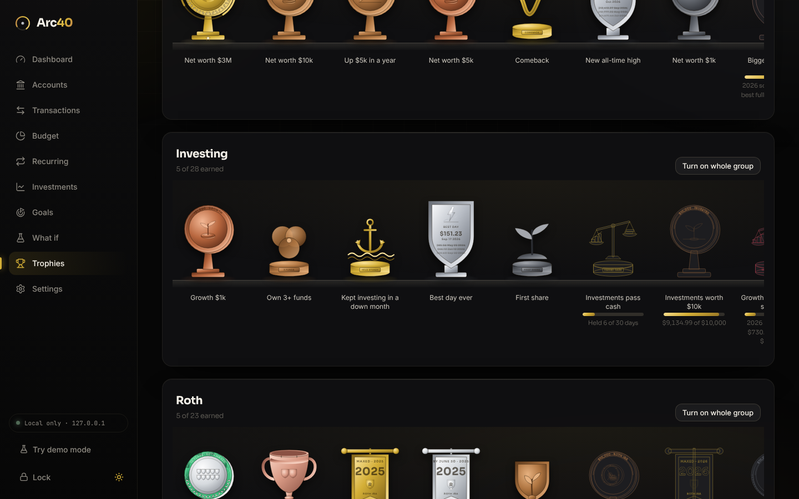

"Investments" means every investment account, valued day by day the same way Accounts and the Dashboard show it (from
fund prices). "Money put in" is contributions and transfers in minus transfers out, with their real sign (the
Investments page rule), and "growth" is value minus money put in. Growth only counts accounts that have Fidelity history,
because an account without it has no record of what was put in. Money market and core cash positions (like SPAXX) are
not funds.

**Investments worth** (coins, 30-day rule): a sapling, a young tree, a full tree, gold leaves, three trees, a small forest,
an ancient tree, then the Arc40 ring around a tree.

| Trophy | Line | Rank |
|---|---|---|
| Investments worth $10k | $10,000 | Bronze |
| Investments worth $25k | $25,000 | Silver |
| Investments worth $50k | $50,000 | Gold |
| Investments worth $100k | $100,000 | Platinum |
| Investments worth $250k | $250,000 | Obsidian |
| Investments worth $500k | $500,000 | Emerald |
| Investments worth $1M | $1,000,000 | Diamond |
| Investments worth $2M | $2,000,000 | Arc40 |
| Investments worth $5M | $5,000,000 | Arc40, 1 star |

**Growth** (coins, 30-day rule on the growth amount): a sprout out of a coin, then a snowball rolling downhill that gets
bigger at each step.

| Trophy | Growth | Rank |
|---|---|---|
| Growth $1k | $1,000 | Copper |
| Growth $10k | $10,000 | Silver |
| Growth $50k | $50,000 | Gold |
| Growth $100k | $100,000 | Platinum |
| Growth $250k | $250,000 | Emerald |
| Growth $500k | $500,000 | Ruby |
| Growth $1M | $1,000,000 | Diamond |

**Invested every month in a row** (streak cups, a chain that gains links and closes into a ring at 12): 6 months Silver,
12 Gold, 24 Platinum, 36 Obsidian, 60 Diamond. A month counts when the net money put in that month is above $0. A month
that ends at $0 or less breaks the run. The current month counts as soon as money has gone in; until then it neither
counts nor breaks the run. The trophy is dated the day the last month of the run went above $0.

**One-of-a-kind:**

| Trophy | Rule | Rank, shape |
|---|---|---|
| First share | The first day you hold shares of any fund (0.001 shares or more) | Iron statuette, a seedling |
| Investments pass cash | Investments worth more than all your cash accounts together (checking, savings, cash), 30 days in a row | Gold statuette, a scale tipping toward a rising chart |
| Growth beats money put in | Growth bigger than all the money you have put in, 30 days in a row (equal does not count) | Ruby statuette, two bars, growth taller |
| Growth beat a year of spending | A full calendar year where growth (the change in growth from Dec 31 to Dec 31) was bigger than that year's spending. Suggests Start from today | Ruby statuette, a chart outweighing a receipt |
| Kept investing in a down month | A finished month where the market took 5% or more off your investments (compared with the value at the end of the month before) and you still put money in. 4.99% does not count; exactly 5% does | Gold statuette, an anchor in rough water |
| Own 3+ funds | Three different funds held on the same day | Bronze statuette, three overlapping circles |
| Best day ever | Your biggest one-day gain from the market (Monday compared with Friday). Both days must have a real closing price for every fund you hold, never an estimated one. Earned on the first new record after 3 months of investment history; every later record is added to the plaque | Silver record plaque, lightning over a chart |

A month or year whose first or last day has no price data at all is skipped for the down month and the year of spending.
If you used "Fix shares" to add shares with no money put in, those shares count as growth here, exactly as the
Investments page counts them.

### Refereeing (17): whistles, flags and stripes

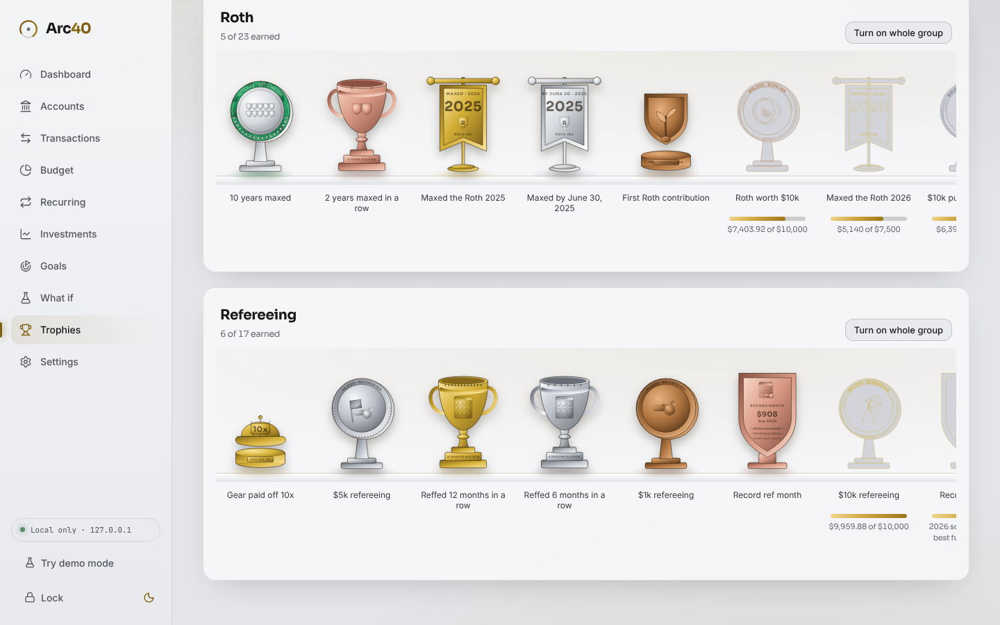

"Ref pay" is income in the category with the Refereeing role and "ref costs" is the category with the ref costs role (Ref
Gear & Fees). They are found by role, never by name, so renaming them is safe. Split pieces count at their own amount, a
refund in Refereeing lowers your pay and a gear refund lowers your costs. Months are calendar months.

**Lifetime ref pay** (coins): a whistle, a whistle and a flag, crossed flags, a striped jersey, a jersey with a crest, a
golden whistle on a stand.

| Trophy | Total | Rank |
|---|---|---|
| $1k refereeing | $1,000 | Bronze |
| $5k refereeing | $5,000 | Silver |
| $10k refereeing | $10,000 | Gold |
| $25k refereeing | $25,000 | Platinum |
| $50k refereeing | $50,000 | Obsidian |
| $100k refereeing | $100,000 | Diamond |

**Ref pay in one month** (coins, a whistle with the amount on its cord): $1k Silver, $2k Gold, $3k Platinum. The
current month counts the day it reaches the line.

**Reffed every month in a row** (streak cups, a scorecard filling with checks): 6 months Silver, 12 Gold, 24 Platinum. A
month counts when it has ref pay above $0; the current month counts once it has pay.

**One-of-a-kind:**

| Trophy | Rule | Rank, shape |
|---|---|---|
| Record ref month | A finished month with more ref pay than every month before it, after at least 3 earlier months with pay. Later records are added | Rose gold record plaque, a calendar page with a whistle |
| Record ref year | A finished year with more ref pay than every earlier full year. Only years Arc40 has your data for from January count, so a part year never makes the next one look like a record | Obsidian record plaque, a jersey with a crown |
| Ref pay up vs last year | The first finished year with more ref pay than the year before (both with data from January) | Bronze statuette, a whistle with a rising arrow |
| Gear paid off 10x | A finished year where ref pay was at least 10 times your ref costs, and the costs were above $0 | Gold statuette, a ref cap marked 10x |
| Ref pay covered all spending | A finished month where ref pay (above $0) was at least as much as everything you spent. Suggests Start from today | Emerald statuette, a whistle under a roof |

## The Round 3 trophies (44)

### Emergency fund and savings (19): umbrellas and jars

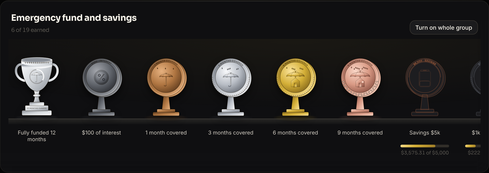

These use the same numbers as the Goals card's emergency fund, worked out for every day:

- **Savings** is the total of your accounts with the Savings type (not archived), valued day by day like the Dashboard.
  An account typed Cash does not count, the same as on the Goals card.
- **The monthly amount** for a day is the average spending of the 6 complete months before that day's month (refunds
  lower it; transfers and gifts never count), plus the optional "costs someone else covers" amount from Goals. That amount has
  no history, so today's value is used for past days too (an earned trophy stays earned).
- **Months covered** is savings divided by the monthly amount. It is compared in whole cents, so exactly 6.00 counts and
  one cent under does not. A day with nothing to measure against yet (no complete month of spending) never counts.
- **Interest** is income in the Interest category. Arc40 marks that category once and finds it by the mark, so renaming
  it is safe. If the category is deleted, the interest trophies wait instead of guessing (a new category that is merely
  named Interest does not count). An interest reversal lowers the total.

**Months covered** (coins, 30-day rule, suggest Start from today): an umbrella that grows as the rain gets heavier.

| Trophy | Months covered | Rank |
|---|---|---|
| 1 month covered | 1 | Bronze |
| 3 months covered | 3 | Silver |
| 6 months covered | 6 | Gold |
| 9 months covered | 9 | Rose gold |
| 12 months covered | 12 | Platinum |

**Stayed fully funded** (streak cups, suggest Start from today): an umbrella inside a ring that fills one third, two
thirds, then all the way. A complete month counts when months covered was 6 or more on every single day of it; one day
under 6 breaks that month. The current month never counts.

| Trophy | Months in a row | Rank |
|---|---|---|
| Fully funded 12 months | 12 | Platinum |
| Fully funded 24 months | 24 | Obsidian |
| Fully funded 36 months | 36 | Emerald |

**Savings balance** (coins, 30-day rule, suggest Count my history): a jar filling up, then two jars, then a row of jars.

| Trophy | Savings | Rank |
|---|---|---|
| Savings $5k | $5,000 | Copper |
| Savings $10k | $10,000 | Bronze |
| Savings $25k | $25,000 | Silver |
| Savings $50k | $50,000 | Gold |
| Savings $100k | $100,000 | Platinum |

**Lifetime interest** (coins, suggest Count my history): a coin with a % sign that gains a sparkle at each step.

| Trophy | Interest, all time | Rank |
|---|---|---|
| $100 of interest | $100 | Iron |
| $1k of interest | $1,000 | Silver |
| $5k of interest | $5,000 | Gold |
| $10k of interest | $10,000 | Platinum |
| $25k of interest | $25,000 | Emerald |

**Refilled after using it** (Rose gold statuette, a drop with a circular arrow, suggests Start from today): the fund was
full (6 months or more) for 30 days in a row, then dropped below 3 months (exactly 3.00 is not below), then climbed back
to 6 or more and held it for 30 days in a row. Earned on that 30th day.

### Spending habits (25): flames, jars, targets and scissors

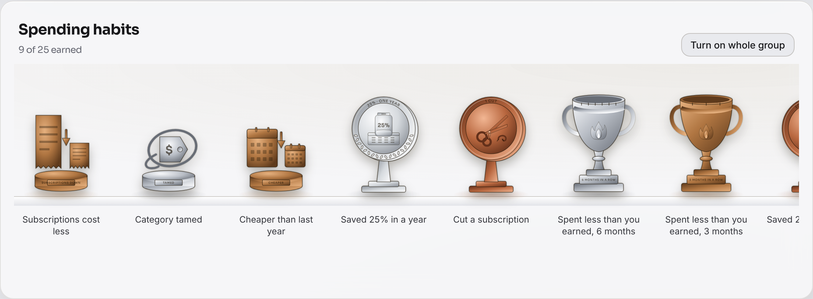

Every Spending habits trophy suggests **Start from today**. They use the same numbers as the rest of Arc40:

- **Income, spending and savings rate** are the Cash flow months: income is money of type income, spending is expenses
  with refunds lowering it, transfers and gifts never count, and savings rate = (income - spending) / income. A month
  with no income has no savings rate (it cannot count; it is not 0%). The rate is the one the Dashboard shows, rounded
  to the hundredth of a percent, so 20.00% counts and 19.99% does not.
- **Only complete months count.** The current month never does, because spending can still come in.
- **A month has data** for a comparison when Arc40's data starts on or before its 1st, so a half-recorded first month
  never looks cheap.
- **Budgets** are the Budget page's limits, month overrides included. Limits have no history: an every-month limit
  applies to past months too.
- **Subscriptions** are the items saved on the Recurring page. One counts as cut when you mark it cancelled there (its
  cancelled date); a cancellation is never guessed from missing charges, and restoring an item takes it out of the count.

**Spent less than you earned, months in a row** (streak cups): a small flame that grows taller, then gains a ring of
embers at 36 and 60 months. A complete month counts when income was above $0 and more than spending; income exactly equal
to spending does not count, and a month with no income breaks the run.

| Trophy | Months in a row | Rank |
|---|---|---|
| Spent less than you earned, 3 months | 3 | Bronze |
| 6 months | 6 | Silver |
| 12 months | 12 | Gold |
| 24 months | 24 | Obsidian |
| 36 months | 36 | Emerald |
| 60 months | 60 | Diamond |

**Savings rate in a month** (coins, a jar marked with the percent and filled to that level): any one complete month at
or above the rate. Saved 20% Copper, 30% Silver, 50% Gold, 70% Platinum.

**Savings rate for a whole year** (coins, the jar sitting on a calendar): one complete calendar year's rate from the
year's totals, never an average of monthly rates (a year with one 100% month and one 0% month can still be a 10% year).
Only years Arc40 has your data for from January count. Saved 25% Platinum, 40% Emerald, 50% Diamond.

**Under budget in every category, months in a row** (streak cups, a bullseye that gains arrows, then a crown at 6 and 24
months): a complete month counts when every category with a budget above $0 that month spent at or under its limit. One
cent over breaks the month. A $0 budget is ignored, and so is spending with no category. A month with no budget above $0
does not count and breaks the run.

| Trophy | Months in a row | Rank |
|---|---|---|
| Under budget for a month | 1 | Silver |
| Under budget 3 months in a row | 3 | Gold |
| Under budget 6 months in a row | 6 | Platinum |
| Under budget 12 months in a row | 12 | Emerald |
| Under budget 24 months in a row | 24 | Diamond |

**Subscriptions cut** (coins, scissors with one more cut loop per step): items marked cancelled on the Recurring page.
Cut a subscription Copper, 3 Silver, 5 Gold, 10 Platinum. Earned on the cancelled date of the one that reaches the count.

**One-of-a-kind:**

| Trophy | Rule | Rank, shape |
|---|---|---|
| Cheaper than last year | A complete month whose spending was lower than the same month one year earlier, both months with data and some spending | Bronze statuette, two calendar pages, the second smaller |
| Subscriptions cost less | At a month end: the charges matched to your saved recurring items over the last 12 complete months total less than over the 12 before. Needs 24 complete months of data | Bronze statuette, a receipt that shrinks |
| Category tamed | At a month end: one spending category's last 12 complete months are at least 25% lower than the 12 before (exactly 25% counts), and the earlier 12 had at least $300 in it. Found by the category itself, so renaming is safe; uncategorized and deleted categories are skipped. The close-up names the category | Silver statuette, a lasso around a price tag |

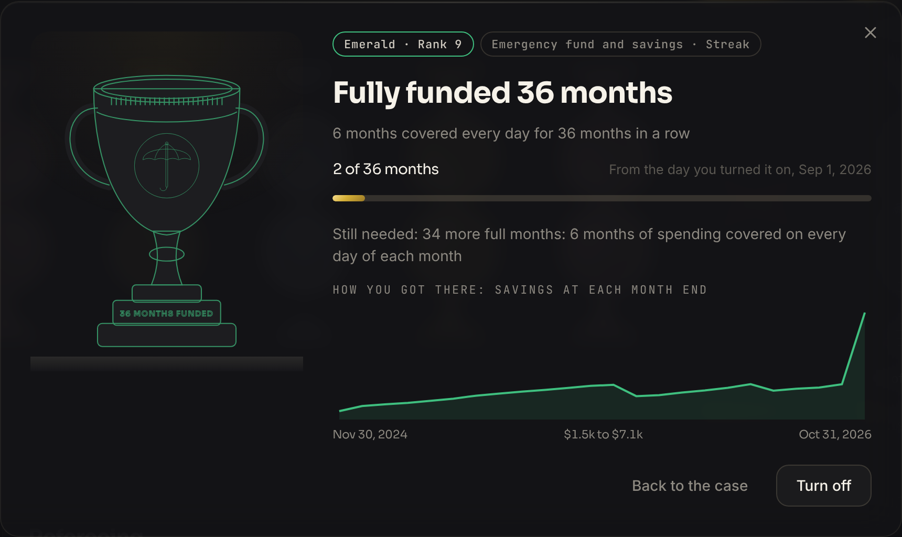

## The activity log

A few Round 4 trophies need things Arc40 did not keep before, so it now keeps a small log (added with the Round 4 update):

- **Backups:** each backup made, with its kind: the weekly automatic one, **Back up now**, the safety backup before an
  update, and the safety backup before an account is deleted.
- **Arc40 Wrapped:** each time you watch a year's Wrapped to its last slide, with the year you watched. Closing it
  earlier records nothing.
- **Positions imports:** each saved Fidelity positions file, with yes or no for "every share count matched" (nothing
  flagged, no Fix shares or Set to 0 needed; accounts you mark Not in Arc40 are left out).

It stores dates, kinds and yes/no answers only: never a file name, a folder, an account name or a number. It started
empty on the day of the update, so the trophies that need it can only count from then, and their close-up says so in plain
words ("Arc40 started keeping track of backups on Nov 20, 2026"). The safety backup made just before that update is the
first backup in the log. One exception: **First backup** can also count an Arc40 backup file that is already in your
backups folder, dated by its name. In demo mode the log is part of the demo, like everything else.

## The Round 4 trophies (47)

### Keeping things tidy (23): ledgers, receipts, gears and locked boxes

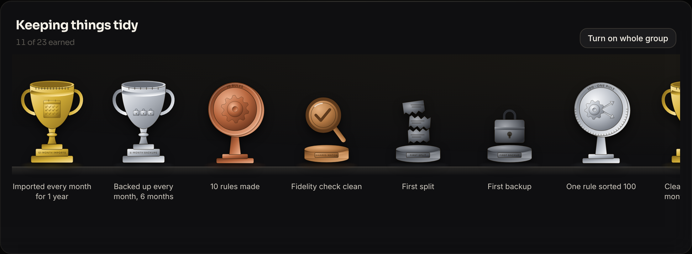

Every Keeping things tidy trophy suggests Count my history.

**Clean books** (streak cups): an open ledger whose lines gain check marks. A complete month counts when it has at least
one income or expense row and none of them is uncategorized (the Transactions page's Uncategorized filter: a split piece
counts on its own). Transfers and gifts never need a category. A month with no income or expense at all does not count and
breaks the run, and Arc40 needs your data from the month's 1st. It uses your data as it is now, so cleaning up an old
month later can complete a run.

| Trophy | Months in a row | Rank |
|---|---|---|
| Clean books for a month | 1 | Iron |
| Clean books, 6 months in a row | 6 | Silver |
| Clean books, 12 months in a row | 12 | Gold |
| Clean books, 24 months in a row | 24 | Platinum |

**Imported every month** (streak cups): one calendar full of checks per year. A month counts when at least one import was
saved that month (the day you imported, not the dates of the rows in the file). An undone import does not count. The
current month counts as soon as it has an import.

| Trophy | Months in a row | Rank |
|---|---|---|
| Imported every month for 1 year | 12 | Gold |
| Imported every month for 2 years | 24 | Platinum |
| Imported every month for 3 years | 36 | Obsidian |

**Transactions tracked** (coins): a receipt that grows into a mountain of receipts. Counted the way the Transactions page
counts its rows, so a transaction split into 3 pieces counts 3. Earned on the date of the row that reaches the count.

| Trophy | Rows | Rank |
|---|---|---|
| 1k transactions tracked | 1,000 | Bronze |
| 5k transactions tracked | 5,000 | Silver |
| 10k transactions tracked | 10,000 | Gold |
| 25k transactions tracked | 25,000 | Platinum |

**Rules made** (coins): one gear, then two meshed gears, then three. Only rules you made count, never the built-in ones.
Deleting a rule lowers the count for the next rung; an earned trophy stays earned.

| Trophy | Rules | Rank |
|---|---|---|
| 10 rules made | 10 | Copper |
| 25 rules made | 25 | Silver |
| 50 rules made | 50 | Gold |

**One rule has sorted** (coins): a gear with sorting arrows that gains more arrows. Arc40 does not record which rule sorted
a transaction, so it works it out by matching: a transaction counts for one of your rules when that rule is the first of
your rules that matches it (the order sorting uses) and the transaction has the type, and the category if the rule sets
one, that the rule sets. A row you changed by hand is not the rule's work. Split transactions never count (rules skip
them). A rule you make today also counts older rows it would have sorted the same way.

| Trophy | Transactions | Rank |
|---|---|---|
| One rule sorted 100 | 100 | Silver |
| One rule sorted 500 | 500 | Gold |
| One rule sorted 1,000 | 1,000 | Platinum |

**Backed up every month** (streak cups, from the activity log): locked boxes lined up in a row. A month counts when at
least one backup of any kind was made that month (a month with only the safety backup before an update counts). The
current month counts as soon as it has one.

| Trophy | Months in a row | Rank |
|---|---|---|
| Backed up every month, 6 months | 6 | Silver |
| Backed up every month, 12 months | 12 | Gold |

**The four statuettes:**

| Trophy | How it is earned | Rank and picture |
|---|---|---|
| First split | The first transaction you split (dated by the transaction: Arc40 does not record when it was split) | Iron, a receipt torn in three |
| Every transfer linked | A complete month with at least one transfer where every transfer is linked to its other side | Bronze, two chain links |
| First backup | The first backup in the log, or an Arc40 backup file already in your backups folder | Iron, a locked box |
| Fidelity check clean | A saved positions file where every share count matched (from the log) | Bronze, a magnifying glass with a check |

### The long game (23): tree rings, flags, stars, ribbons and the case

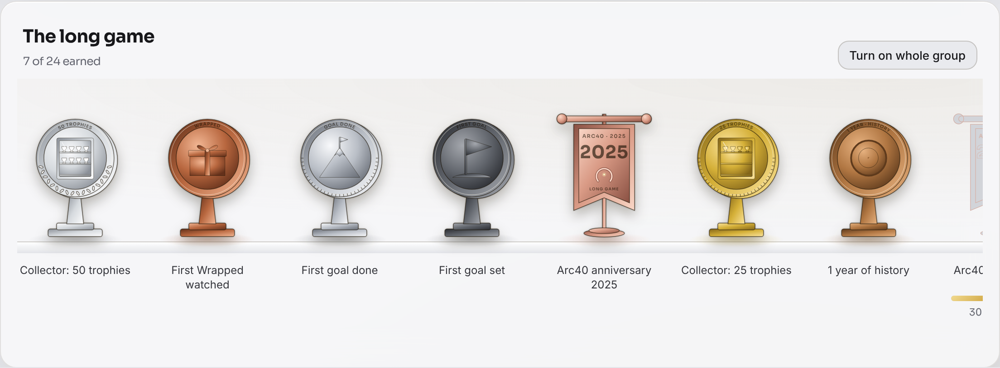

All suggest Count my history except **Perfect months** and **Perfect year**, which include spending and suggest Start
from today.

**Years of history** (coins): tree rings, one ring per year. Counted from the first day Arc40 has money data for (the
earliest transaction, balance or investment activity). Earned on that day, N years later (a Feb 29 start counts on Feb
28).

| Trophy | Years | Rank |
|---|---|---|
| 1 year of history | 1 | Bronze |
| 3 years of history | 3 | Gold |
| 5 years of history | 5 | Obsidian |
| 10 years of history | 10 | Diamond |
| 20 years of history | 20 | Arc40 |

**Goals** (coins): a flag planted in the ground, a flag on a summit, then ridges with more flags. "Set" is a goal you made
(its created day). "Done" is a goal whose progress, the number the Goals page shows (its account's balance), stayed at or
above its target for 30 days in a row, counting from the day you set it (so a goal already met when you make it is done
30 days later). A goal with no account never shows progress, so it cannot be done. Arc40 saves each goal's set and done
days, so deleting a goal later never lowers the count.

| Trophy | Goals | Rank |
|---|---|---|
| First goal set | 1 set | Iron |
| First goal done | 1 done | Silver |
| 5 goals done | 5 done | Platinum |
| 10 goals done | 10 done | Obsidian |
| 25 goals done | 25 done | Emerald |

**Perfect months** (coins, Start from today): a star with one part of a perfect month in each point (a flame, a bullseye,
a ledger check and a sprout) that gains a glow, sparkles and rays as it climbs. Counted in total, not in a row. A perfect
month is a complete month (your data from its 1st) where all four are true, with the same rules as their own trophies:

1. income was above $0 and more than spending (Spent less than you earned);
2. every category with a budget above $0 stayed at or under it (Under budget). A month with no budget above $0 does not
   count, so a perfect month needs at least one real budget;
3. clean books: nothing uncategorized (and at least one income or expense row);
4. more money went into your investments than came out (the Investing streak's monthly money put in, above $0).

| Trophy | Perfect months | Rank |
|---|---|---|
| A perfect month | 1 | Gold |
| 3 perfect months | 3 | Platinum |
| 6 perfect months | 6 | Emerald |
| 12 perfect months | 12 | Ruby |

**A perfect year** (Diamond streak cup, Start from today): the star on the front of a cup. 12 perfect months in a row.

**Wrapped watched** (coins, from the activity log): a box tied with a ribbon that gains ribbons. Counts different years
whose Arc40 Wrapped you watched to the last slide: watching the same year twice counts once, and a past year watched
today counts.

| Trophy | Years watched | Rank |
|---|---|---|
| First Wrapped watched | 1 | Copper |
| 5 years of Wrapped | 5 | Gold |
| 10 years of Wrapped | 10 | Platinum |

**Arc40 anniversary** (Rose gold yearly banner): the Arc40 arc with its glowing core, "ARC40 · year" on the banner. One per
year, earned on the day you first set up Arc40 (made your password), one year later and every year after (a Feb 29 setup
counts on Feb 28). The coming year's banner shows a countdown ("30 days to go"), and like the Roth banners, a new year's
banner starts On when last year's was On or Earned.

**Collector** (coins): a tiny trophy case that fills up, the last one full and glowing. Counts trophies earned right now;
each yearly trophy counts on its own (Maxed 2026 and Maxed 2027 are two). A trophy you took back is Off, so it does not
count until it is earned again (an earned Collector trophy stays earned). Collector trophies never count toward each
other. **Every trophy** means every other trophy in the case (175, The Arc included) earned at least once; a yearly kind
needs one year. Collector is checked after every other trophy, so earning your 25th trophy and Collector 25 can happen in
the same moment, and it comes after the others in the unlock queue.

| Trophy | Trophies earned | Rank |
|---|---|---|
| Collector: 25 trophies | 25 | Gold |
| Collector: 50 trophies | 50 | Platinum |
| Collector: 100 trophies | 100 | Diamond |
| Collector: every trophy | All 175 others | Arc40 |

### The Arc (1): the one and only

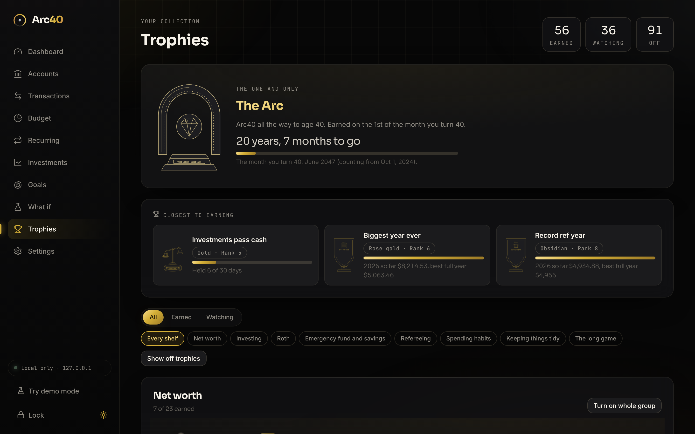

The Arc is not on a shelf: it has its own spot at the top of the Trophy Case, above Closest to earning, and the filters
never hide it. It still shows in the close-up, the unlock moment and the Dashboard card like any other trophy.

- **Earned** on the 1st of the month you turn 40, as long as your history in Arc40 started before then (Arc40 was there
  along the way). It uses the birth month and year from Settings > Planning, and it starts Off like every trophy (Turn on
  uses Count my history).
- **No birth month saved:** the spot shows The Arc as Off with "Set your birth month in Settings to watch The Arc",
  linking to Settings. Arc40 never guesses an age.
- **Watched:** time, not money: "20 years, 7 months to go", with a bar from the first day of your history to the month you
  turn 40.
- **The picture:** its own shape: the Arc40 ring opened up like a doorway, thick gold with a darker edge and fine dashed
  engraving along it, a diamond-cut gem with a soft gold glow floating in the opening, on a stepped dark base with a gold
  plate reading "THE ARC · AGE 40". Off is the faint ghost, On a thin gold outline, Earned fully lit with the gem glowing.
- **The moment:** always the last in the queue, with the grandest chime (a longer version of the Arc40 sound, about 3
  seconds).

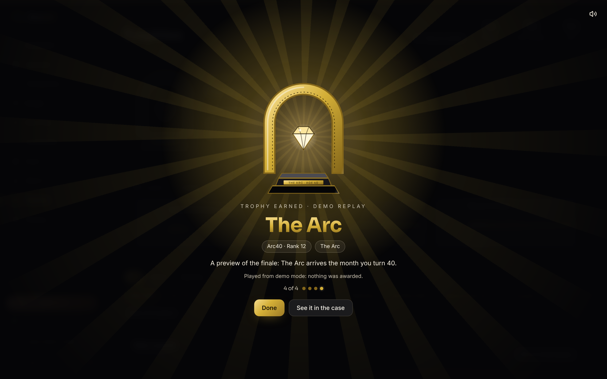

## "Start from today" for each kind

- Balance holds: only days from the day you turned it on count.
- Lifetime totals: only money put in from that day on counts.
- Records, years maxed, a comeback, a first contribution: it has to happen on or after that day.
- Yearly Roth banners: the whole year's contributions still count (the IRS limit is about the whole year), but the year
  has to get maxed on or after that day.
- Streaks and one-month totals: only money from that day on counts.
- Ref pay covered all spending: the month has to start on or after that day (the first full month).
- Growth beat a year of spending and the other Round 2 full-year trophies: the year has to end on or after that day.

For the Round 3 trophies:

- **30-day holds** (months covered, savings balance): the hold can only start on or after the day you turned it on.
- **Months** (streaks, a single good month): only months that start on or after that day count. Turned on Nov 17,
  December is the first month that can count; turned on Dec 1, December counts (the whole month is watched).
- **Years** (a whole year's savings rate): only calendar years that start on or after that day. Turned on Nov 17, 2026,
  the first year that can count is 2027.
- **Comparisons** (cheaper than last year, subscriptions cost less, category tamed): the month or 12 months being judged
  must start on or after that day, but the earlier period it is compared with can be from before. That is the point of a
  comparison. It also means the 12-month ones can first be earned about a year after you turn them on.
- **Events:** a subscription cut must be cancelled on or after that day. Refilled: the whole story (full, the drop, the
  refill) has to happen on or after it.
- **Lifetime interest:** only interest from that day on counts.

For the Round 4 trophies (the same rules Round 3 settled):

- **Months** (clean books, imports, backups, every transfer linked, perfect months and the perfect year): only months that
  start on or after the day you turned it on. For imports and backups, an import or backup in the turn-on month itself
  only counts if you turned it on the 1st.
- **Counts and firsts** (transactions tracked, rules made, one rule has sorted, a first split, backup, Fidelity check,
  goal set or done, Wrapped watched, Collector): only things dated on or after that day.
- **Years of history:** counted from the later of your first money day and the turn-on day.
- **Anniversary and The Arc:** the day itself has to be on or after the turn-on day.

## Demo mode

The demo has a full case to look at: trophies its fake numbers really earn, a few watched ones (one in Start from today
mode), and five "showcase" awards so every shape, a gem rank and an Arc40 star level can be seen lit. Their sentence
starts with "Demo showcase:" so it is clear the demo set them. The Investing and Refereeing shelves show every state too,
including record plaques with older records struck through. The Emergency fund and savings and Spending habits shelves
show every state as well: earned coins, cups and three statuettes, a cup halfway through its run, and two trophies counting
from today. Two older months of fake history and a made-up "StreamPlus Sports" plan, cancelled a year ago, give the
12-month comparisons a full two years and a real subscriptions story. Demo trophies count as already celebrated, so entering demo
mode opens no moment.

**Play an unlock** (on the Trophies page, demo mode only) plays the moment with three demo trophies of rising rank (a
Silver, a Gold and an Arc40 star level), then **The Arc** as the finale (a preview of how it arrives), so you can see the
whole queue. It awards nothing and marks nothing as seen.

The Keeping things tidy and The long game shelves show every state too. The demo gets fake activity log rows (backups
most weeks for 7 months, last year's Wrapped watched, a positions file with a share count flagged and then a clean one), a
fake empty import in each of the last 14 months, a dozen fake rules, a fake "Laptop fund" goal and a setup day almost two
years back, so the log-based trophies, a goal done and last year's anniversary are earned, while a Clean books cup counts
from today halfway into its run. **The Arc** is watched with its time progress, using a made-up birth month.

Clicking in demo mode only changes the demo; your real data is never touched. **Reset demo data** in Settings puts the
demo trophies back.

## The plan for all four rounds

Each round only adds trophies, designs and screens; the trophy system, the page and the drawings stay as they are.

1. **Round 1, the foundation** (done): the trophy system, the Trophy Case page, the close-up, all five shapes, all 12
   ranks, demo trophies, and the 43 Net worth and Roth trophies.
2. **Round 2, the moments** (done): the unlock moment (shown once per award, in a queue), trophy sounds, the Dashboard
   shelf, "Play an unlock" in demo mode, and the 45 Investing and Refereeing trophies.
3. **Round 3, the spending trophies** (done): the 44 Emergency fund and savings and Spending habits trophies with their
   two design families.
4. **Round 4, the finish** (done): the activity log, the 23 Keeping things tidy and 23 The long game trophies (Collector
   included) with their two design families, and The Arc in its own spot at the top of the case.

**The Trophy Case is complete: 179 trophies in eight shelves and The Arc.** Every trophy starts Off on purpose, so you
choose which ones count and when.
